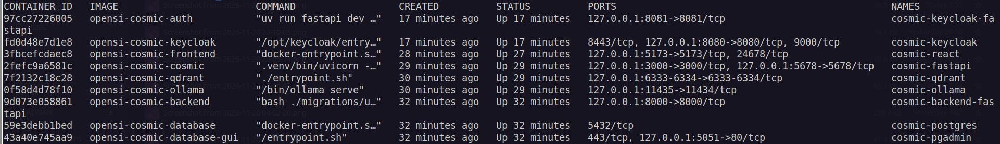

# CoSMIC Starter

A single entry-point script for setting up and running the full CoSMIC stack across any machine. It handles cloning, branch switching, config generation, and bringing up all three services in the correct order.

## Prerequisites

- Docker
- Docker Compose **v2** (Tested on v5.1.3).
- Git
- Bash

## Usage

```bash
git clone https://github.com/TheOpenSI/CoSMIC_Starter.git
cd CoSMIC_Starter
bash run.sh
```

## Workflow

The script presents five options at startup: **Start**, **Stop**, **Docker Cleanup**, **Logs** and **Prepare**.


Choosing **Start** runs through the following stages:

1. **Repositories** — clones cosmic-core, cosmic-db, cosmic-platform and cosmic-auth if they are not already present.
2. **Branch selection** — asks which branch to use for each repo (defaults to `Development` / `dev` / `development` / `dev`).
3. **Checkout & pull** — fetches from remote and checks out the selected branch, pulling the latest changes.
4. **Docker options** — asks whether to pull latest images, build from source, or run a system prune.
5. **cosmic-db config** — Runs bins/setup.sh.
6. **cosmic-core config** — creates a `.env` file from example.
7. **cosmic-platform config** — creates a `.env` from the example.
8. **cosmic-auth config** — Runs bins/setup.sh
9. **Start containers** — Starts the containers in the following order: db, core, auth and plaform (UI).

Once everything is running the script prints the service URLs and offers to tail the CoSMIC logs.

## Service ports
