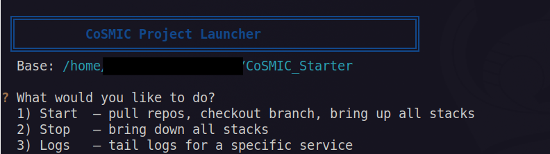

# CoSMIC Starter

A single entry-point script for setting up and running the full CoSMIC stack across any machine. It handles cloning, branch switching, config generation, and bringing up all three services in the correct order.

## Prerequisites

- Docker
- Docker Compose **v2** (Tested on v5.1.3).
- Git
- Bash

## Usage

```bash
git clone https://github.com/TheOpenSI/CoSMIC_Starter.git
cd CoSMIC_Starter
bash start.sh
```

On first run the script will clone the repos and walk you through setup. On subsequent runs it skips anything already done.

## Workflow

The script presents three options at startup: **Start**, **Stop**, or **Logs**.



Choosing **Start** runs through the following stages:

1. **Repositories** — clones CoSMIC, CoSMIC_DB, and CoSMIC_UI if they are not already present.
2. **Branch selection** — asks which branch to use for each repo (defaults to `Development` / `dev` / `development`).
3. **Checkout & pull** — fetches from remote and checks out the selected branch, pulling the latest changes.
4. **Docker options** — asks whether to pull latest images, build from source, or run a system prune.
5. **CoSMIC_DB config** — copies example credential and config files into the correct locations under `CoSMIC_DB/docker/`. Skipped on subsequent runs.
6. **CoSMIC config** — creates a `.env` file in `CoSMIC/` with your Ollama service name. Skipped if already present.
7. **CoSMIC_UI config** — creates a `.env` from the example file in `CoSMIC_UI/`. Skipped if already present.
8. **Start CoSMIC_DB** — brings up the database stack and waits for Postgres to be ready.
9. **Start CoSMIC** — brings up the main CoSMIC stack (Ollama, FastAPI, Qdrant).
10. **Start CoSMIC_UI** — brings up the frontend dev server.

Once everything is running the script prints the service URLs and offers to tail the CoSMIC logs.

## Service URLs

| Service | URL |
|---|---|
| CoSMIC API | http://localhost:3000 |
| CoSMIC UI | http://localhost:5173 |
| FastAPI (DB) | http://localhost:8000 |
| PgAdmin | http://localhost:5050 |
